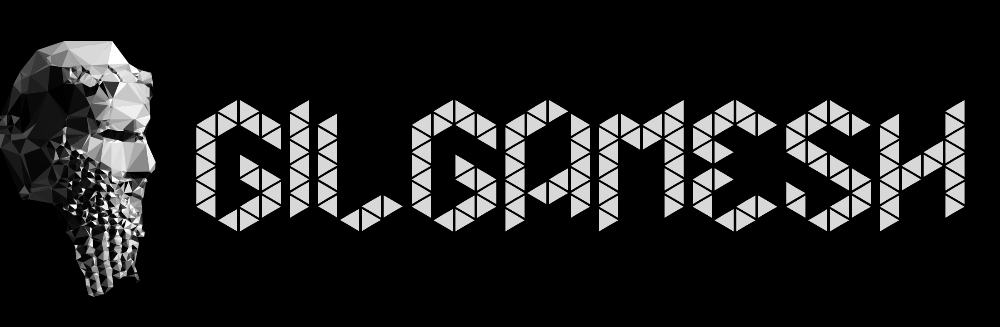
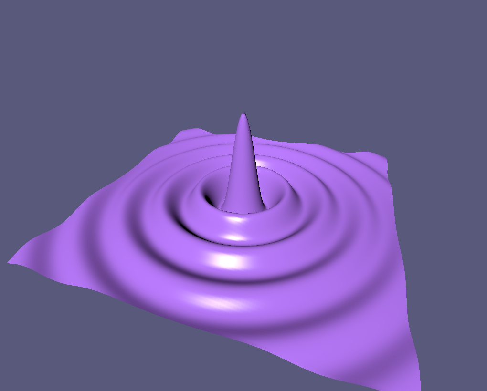

# Gilgamesh



[](https://github.com/BarthPaleologue/Gilgamesh/actions/workflows/rust.yml)
[](https://crates.io/crates/gilgamesh)
[]()

A small 3D WGPU engine written in Rust that does not rely on the ECS pattern.

## Features

- Up to 64 point lights per render pass
- Up to 64 directional lights per render pass
- PBR and normalized Phong shading
- Photometric lighting (candelas, lux, nits) and photographic camera exposure
- Normal mapping
- Procedural mesh generation

## Coming Soon

- Shadow mapping
- GLTF support



## Getting Started

Requires Rust 1.99 or newer. `rust-toolchain.toml` selects the stable toolchain,
Rustfmt, Clippy, and the `wasm32-unknown-unknown` target.

```sh
cargo build --locked
cargo test --locked
cargo build --locked --target wasm32-unknown-unknown
```

Example textures use [Git LFS](https://git-lfs.com/). After cloning, run `git lfs install` and `git lfs pull`.

Run the examples on desktop:

```sh
cargo demo terrain
cargo demo starsystem
cargo demo headless
cargo demo splitscreen
cargo demo game_of_life
```

For the browser, install [wasm-server-runner](https://github.com/jakobhellermann/wasm-server-runner)
once with `cargo install wasm-server-runner`, then run an example and open the printed URL:

```sh
cargo demo-wasm terrain
cargo demo-wasm starsystem
cargo demo-wasm headless
cargo demo-wasm splitscreen
cargo demo-wasm game_of_life
```

The headless example exports `headless.png` to disk on desktop or as a download in the browser.
Browser screenshots require WebGPU.

The splitscreen example compares scene color with raw reverse-Z depth (near is white, infinity is black).
Move the mouse horizontally to slide the split; drag to orbit and scroll to zoom.

The Game of Life example requires compute support (WebGPU in browsers).
Press Space to pause or resume, and R to generate a new random grid.

Implement `App` to own and update your camera, controls, and meshes.
Here is a procedural terrain example:

```rust,no_run
use gilgamesh::blocks::{expose, rasterize, tone_map};
use gilgamesh::camera::{Camera, Perspective};
use gilgamesh::core::{App, FrameBindingsData, FrameContext, WGPUContext, WindowRuntime};
use gilgamesh::core::render_graph::{RenderGraph, TextureFormat};
use gilgamesh::geometry::{Mesh, procedural};
use gilgamesh::input::OrbitControl;
use gilgamesh::lights::DirectionalLight;
use gilgamesh::materials::BlinnPhongMaterial;
use gilgamesh::transform::Transformable;
use glam::DQuat;
use std::rc::Rc;

struct TerrainApp {
    camera: Camera<Perspective>,
    orbit_control: OrbitControl,
    terrain: Mesh,
    directional_lights: [DirectionalLight; 1],
}

impl App for TerrainApp {
    fn new(ctx: &WGPUContext) -> Self {
        let camera = Camera::default();
        let mut orbit_control = OrbitControl::default();
        orbit_control.set_radius(10.0);

        let cpu_buffers = procedural::terrain(10.0, 128, &|x, z| {
            let d = 5.0 * (x * x + z * z).sqrt();
            3.0 * (d.sin() / d).min(1.0)
        });
        let mut material = BlinnPhongMaterial::new("sincMaterial");
        material.set_diffuse_color(0.5, 0.2, 1.0);
        let terrain = Mesh::from_cpu_buffers("sinc", &cpu_buffers, Rc::new(material.into()), ctx);

        Self { camera, orbit_control, terrain, directional_lights: [DirectionalLight::default()] }
    }

    fn name(&self) -> &str {
        "Sinc function"
    }

    fn update_before_frame(&mut self, frame: &FrameContext<'_>) {
        self.orbit_control.update(&mut self.camera, frame.mouse, frame.delta_seconds);
        self.terrain.transform_mut().rotation = DQuat::from_rotation_y(frame.elapsed_seconds);
    }

    fn frame_graph(&self) -> RenderGraph<'_> {
        let mut graph = RenderGraph::new();
        let scene = rasterize(
            FrameBindingsData::new(&self.camera, &self.directional_lights, &[]),
            [&self.terrain],
            TextureFormat::Rgba32Float,
            [3_840.0, 3_840.0, 7_680.0, 1.0],
            &mut graph,
        );
        let exposed = expose(scene.color, self.camera.exposure, TextureFormat::Rgba16Float, &mut graph);
        let image = tone_map(exposed, TextureFormat::Rgba8UnormSrgb, &mut graph);
        graph.export(image);
        graph
    }
}

fn main() {
    WindowRuntime::<TerrainApp>::run(1000, 800);
}
```

## About

Loosely based
on [Dr. Xu youtube series](https://www.youtube.com/watch?v=i6WMfY-XTZE&list=PL_UrKDEhALdJS0VrLPn7dqC5A4W1vCAUT)
and the [WGPU tutorial](https://sotrh.github.io/learn-wgpu/).
